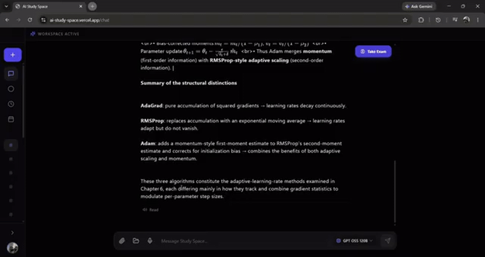

# 🧠 AI Study Space

> Your intelligent second brain for hyper-focused learning and autonomous knowledge synthesis.

[](https://ai-study-space.vercel.app/)
[](https://opensource.org/licenses/MIT)



**AI Study Space** is a full-stack, AI-powered learning platform designed to help students, researchers, and professionals learn faster and retain more information. By combining Retrieval-Augmented Generation (RAG), dynamic 2D knowledge graphs, and spaced repetition, it transforms passive reading into active, hyper-focused learning.

---

## ✨ Features

- 📚 **Global Document Vault & RAG Dialogue**: Ingest PDFs, Word documents (DOCX/DOC), PowerPoint presentations (PPTX/PPT), OCR-scanned images, or live web URLs. The system segments, embeds, and contextualizes materials, allowing real-time semantic dialogue with citations.
- 🎓 **AI Examiner Mode & Spaced Repetition**: Don't just read—test your comprehension. The AI generates multi-choice competency evaluations from your uploaded context. Incorrect answers are automatically routed to the "I Don't Know" (IDK) review deck powered by spaced repetition principles.
- 🕸️ **Auto-Generated Knowledge Graphs**: Watch your brain expand. As you converse, the AI extracts core concepts and relationships, rendering an interactive, physics-based 2D force-directed network topology of your evolving knowledge base.
- ⏱️ **Deep Focus Chronometer & Goal Tracking**: A built-in Pomodoro timer with restorative break intervals seamlessly integrates with an objective tracker. Define targets (e.g., "10 hours of Distributed Systems") and monitor real-time completion percentages.
- 🎙️ **Voice Q&A**: Hands-free multimodal interaction. Dictate questions using Groq Whisper speech-to-text, and vocalize answers using text-to-speech audio synthesis.
- 🔐 **Multi-Tenancy & Session Persistence**: Integrated with Google OAuth and guest mode. Workspaces, transcripts, vector indices, and telemetry are isolated and safely synced to MongoDB Atlas.

---

## 🛠️ Tech Stack

### Frontend (`client/`)
- **Framework**: React 18 + Vite
- **State Management**: **Zustand** (Decoupled, selector-driven architecture replacing monolithic Context providers)
- **Styling**: Tailwind CSS + Lucide Icons (Neo-brutalist dark glassmorphic design)
- **Knowledge Graph Visualization**: `react-force-graph-2d`
- **Analytics & Telemetry**: `recharts`
- **Markdown & Math**: `react-markdown` + `remark-math` + `rehype-katex` + `react-syntax-highlighter`
- **Hosting / Deployment**: Vercel

### Backend (`server/`)
- **Framework**: FastAPI (Modular Blueprint Architecture)
- **AI / LLM Orchestration**: LangChain Core & Community
- **Model Providers**: Groq Cloud (GPT-OSS, Qwen), Google Gemini (2.5 Flash / Pro), Mistral AI
- **Vector Database**: Pinecone Cloud Vector DB
- **Embeddings**: ONNX FastEmbed (`all-MiniLM-L6-v2`) for ultra-low memory footprints (<512MB RAM)
- **Primary Database**: MongoDB Atlas (Async Motor driver)
- **Audio Transcription**: Groq Whisper Large v3
- **Hosting / Deployment**: Render

---

## 🏛️ Architectural Defense & Technical Overview

This codebase has been architected from the ground up for high reliability, clean modularity, and enterprise scalability:

1. **Decoupled Zustand State Store**: Eliminates cascading re-renders caused by monolithic Context APIs. Component subscribers only re-render when their individual slice mutates.
2. **Modular Blueprint Pattern**: Replaces flat route files with structured domain controllers (`dialogue`, `ingest`, `assessment`, `ontology`, `metrics`, `pulse`).
3. **Thread-Safe Vector IO**: `ThreadSafePineconeStore` intercepts vector searches and delegates them to background worker threads, preventing event-loop teardown crashes.
4. **Adaptive Multi-Query Search**: Queries are expanded into multiple conceptual variations in parallel, deduplicating document fragments before prompt synthesis.
5. **Debounced Cloud Autosave**: Dedicated reactive synchronization hook buffers workspace mutations, preventing database contention.

---

## 🚀 Quick Start (Local Development)

### 1. Clone the repository
```bash
git clone https://github.com/LostAlien96/AI-Study-Space.git
cd AI-Study-Space
```

### 2. Backend Setup
```bash
# Create and activate virtual environment
python -m venv venv
source venv/bin/activate  # On Windows: venv\Scripts\activate

# Install Python dependencies
pip install -r requirements.txt

# Create a .env file in the root directory:
# MONGODB_URL=mongodb+srv://<username>:<password>@cluster0.mongodb.net/?retryWrites=true&w=majority
# PINECONE_API_KEY=your_pinecone_api_key
# PINECONE_INDEX_NAME=second-brain-index
# GROQ_API_KEY=your_groq_api_key
# GOOGLE_API_KEY=your_gemini_api_key
# MISTRAL_API_KEY=your_mistral_api_key

# Start the FastAPI server
python main.py
```
Backend runs at `http://localhost:8000`.

### 3. Frontend Setup
```bash
# In a new terminal, navigate to the client directory
cd client

# Install NPM packages
npm install

# Start Vite dev server
npm run dev
```
Frontend runs at `http://localhost:5173`.

---

## 🤝 Contributing
Contributions, issues, and feature requests are welcome! Feel free to check the [issues page](https://github.com/LostAlien96/AI-Study-Space/issues).

## 📝 License
This project is [MIT](https://choosealicense.com/licenses/mit/) licensed.
